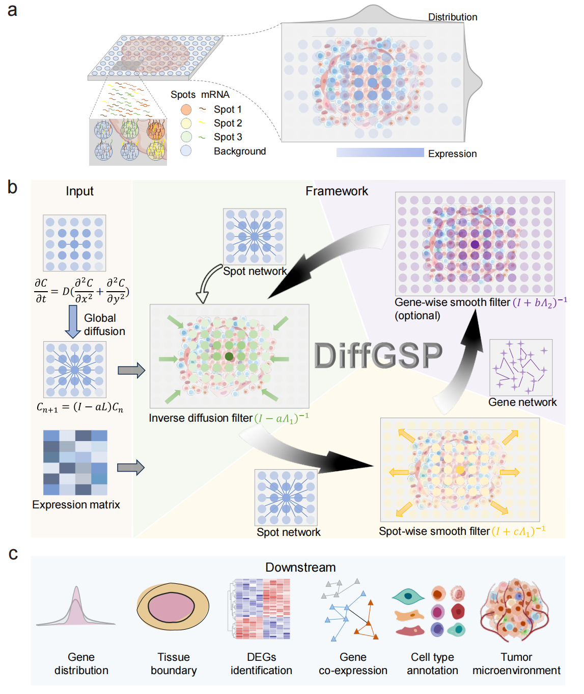

# DiffGSP: reversing mRNA diffusion to unlock high-fidelity spatial transcriptomics

    




## System Requirements

### OS Requirements

DiffGSP is based on Python and can run on both Windows and Linux. The package has been tested on the following systems:

- Linux (recommended): CentOS 7.9.2009, Ubuntu 18.04, Ubuntu 20.04
- Windows: Windows 10

### Python Dependencies

DiffGSP requires Python >= 3.9. The package has been tested with Python 3.9.0.

The following package versions have been tested:

```text
numpy==2.0.2
pandas==2.3.3
scipy==1.13.1
scikit-learn==1.6.1
tqdm==4.67.1
matplotlib==3.9.4
leidenalg==0.10.0
ipython==8.18.1
kneed==0.8.5
scanpy==1.10.0
```

## Installation Guide

### Create a Virtual Environment

We recommend users create a virtual environment using Conda. Users can install `anaconda` or `miniconda` according to the guide at [https://www.anaconda.com/].

Create a virtual environment by running:

```shell
conda create -n diffgsp_env python=3.9.0
conda activate diffgsp_env
```

### Download DiffGSP

Run:

```shell
git clone https://github.com/jxLiu-bio/DiffGSP
cd ./DiffGSP
```

### Install DiffGSP

After completing the above procedures, install DiffGSP by running:

```shell
pip install .
```

### Install PyTorch

DiffGSP supports GPU acceleration through PyTorch.

For the tested environment with CUDA 12.4, install PyTorch and Torchvision using:

```shell
pip install torch==2.6.0 torchvision==0.21.0 --index-url https://download.pytorch.org/whl/cu124
```

For CPU-only environments, use:

```shell
pip install torch==2.6.0 torchvision==0.21.0 --index-url https://download.pytorch.org/whl/cpu
```

For optional GPU acceleration using CuPy with CUDA 12.x, install:

```shell
pip install cupy-cuda12x==13.6.0
```

Users can select the appropriate PyTorch version according to their CUDA environment. For other configurations, please refer to the [official PyTorch installation guide](https://pytorch.org/get-started/locally/).

### Test Installation

After installing DiffGSP and its required dependencies, launch Python:

```shell
python
```

Then run the following code:

```python
import DiffGSP as dg
```

If no errors occur, DiffGSP has been successfully installed.

### Install Jupyter (Optional)

We recommend [Jupyter](https://jupyter.org/) for interactive usage. It can be installed and configured by running:

```shell
pip install jupyter ipykernel
python -m ipykernel install --user --name=diffgsp_env --display-name=diffgsp_env
```

## Usage and Tutorials

The detailed step-by-step usage guide can be found at <https://diffgsp.readthedocs.io/en/latest/>.