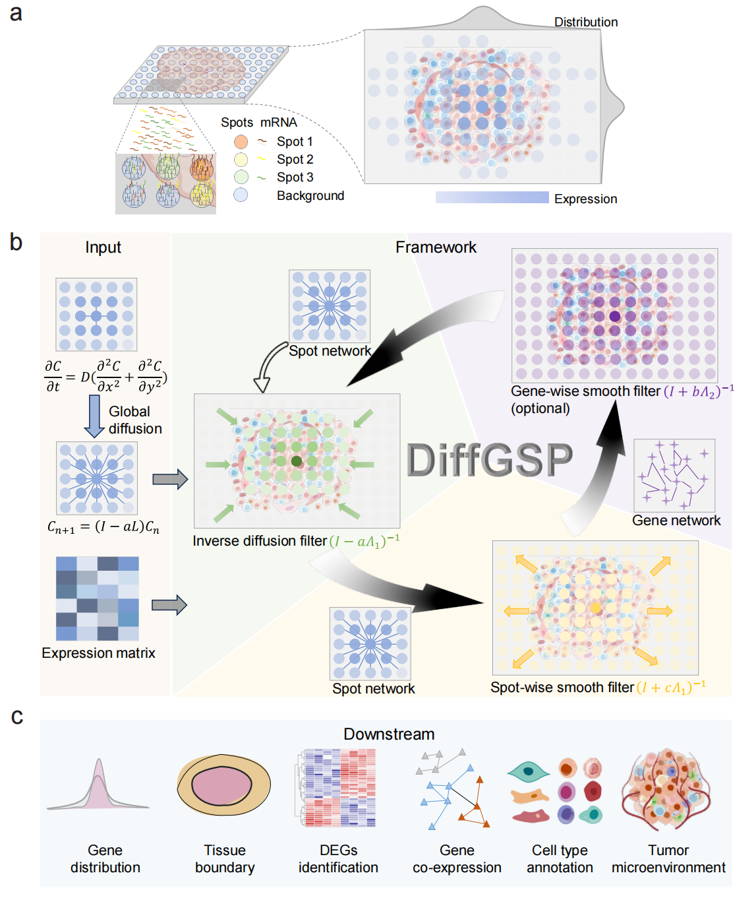

## About

`DiffGSP` is a physics-informed framework that integrates Fick’s law with graph signal processing to explicitly model and reverse mRNA diffusion-induced distortions in spatial transcriptomics. By computationally recovering the underlying spatial gene expression landscape, DiffGSP improves spatial fidelity and enables more reliable biological interpretation. Comprehensive benchmarking across diverse datasets demonstrates its ability to restore fine-scale spatial gene expression patterns and reveal biologically meaningful structures, including anatomical organization in the mouse brain, spatially organized gene modules in the kidney, intratumoral heterogeneity in colorectal cancer, and tertiary lymphoid structures in lung adenocarcinoma. With its physically interpretable framework, DiffGSP is broadly applicable to various sequencing-based spatial transcriptomics platforms.

### DiffGSP Advantages

1. **Physics-informed modeling:** DiffGSP is grounded in Fick’s law of diffusion and graph signal processing, providing a physically interpretable framework for correcting mRNA diffusion rather than relying solely on empirical denoising approaches.
2. **High-fidelity spatial reconstruction:** DiffGSP reverses diffusion-induced spatial distortions, restoring fine-scale gene expression patterns and improving the reliability of downstream biological analyses.
3. **Broad applicability:** DiffGSP supports various sequencing-based spatial transcriptomics platforms and enables the investigation of diverse biological structures and spatial patterns.

